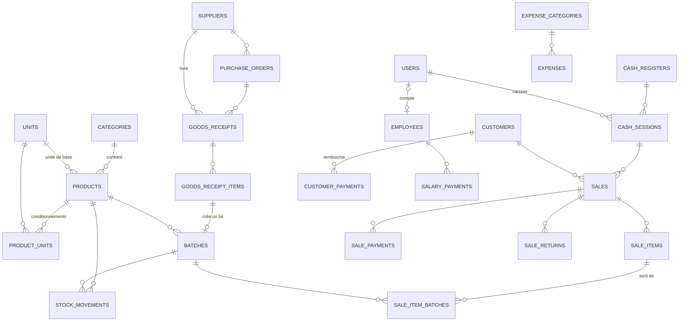

# Gestion Stock Dépôt — Schéma de la base de données

34 tables, réparties en 7 migrations (+ tables Spatie Permission et Activity Log).

## Installation

```bash
composer require spatie/laravel-permission spatie/laravel-activitylog
php artisan vendor:publish --provider="Spatie\Permission\PermissionServiceProvider"
php artisan vendor:publish --provider="Spatie\Activitylog\ActivitylogServiceProvider" --tag="activitylog-migrations"
# copier database/migrations/*.php et database/seeders/*.php dans le projet
# ajouter le trait HasRoles au modèle User + 'is_active' dans $fillable
php artisan migrate
php artisan db:seed --class=RolesAndPermissionsSeeder
```

Compte initial : `admin@depot.local` / `ChangeMoi@2026` (à changer immédiatement).

## Tables par module

| Migration | Tables |
|---|---|
| 01 Base | `users` (+phone, avatar, is_active, last_login_at), `settings`, `exchange_rates` |
| 02 Catalogue | `categories`, `brands`, `units`, `products`, `product_units` |
| 03 Achats | `suppliers`, `purchase_orders`, `purchase_order_items`, `goods_receipts`, `goods_receipt_items`, `supplier_payments` |
| 04 Stock | `batches`, `stock_movements`, `stock_adjustments`, `stock_adjustment_items`, `inventory_counts`, `inventory_count_items` |
| 05 Clients & caisse | `customers`, `cash_registers`, `cash_sessions`, `cash_movements`, `customer_payments` |
| 06 Ventes | `sales`, `sale_items`, `sale_item_batches`, `sale_payments`, `sale_returns`, `sale_return_items` |
| 07 RH & dépenses | `employees`, `salary_payments`, `expense_categories`, `expenses` |
| 08 Numérotation | `reference_sequences` (V-2026-000001, REC-2026-0001… sans doublon) |

## Couche métier (app/Services)

| Service | Rôle |
|---|---|
| `StockService` | **Seul** point qui modifie le stock : `addOpeningStock`, `receive` (réception fournisseur, transport réparti, coût moyen pondéré, dette fournisseur), `consume` (FEFO, ignore les lots expirés), `restore`, `approveAdjustment`, `validateInventory` |
| `SaleService` | `create` (vente atomique : prix détail/gros, remises plafonnées, paiements multiples HTG/USD, crédit avec limite), `completeHeld`, `cancel` (stock remis dans les mêmes lots), `processReturn` (partiel, avec ou sans remise en stock) |
| `CashSessionService` | `open`, `summary` (attendu en tiroir HTG/USD), `close` (écart manquant/excédent) |
| `ReferenceGenerator` | Numéros de documents séquentiels verrouillés |

Les erreurs métier lèvent `BusinessException` (message affichable tel quel, rendu en 422 JSON ou `back()->with('error')`).

Paramètres utilisés : `max_discount_percent` (défaut 10), `default_usd_rate` (si aucun taux saisi).

## Tests

`tests/Feature/SaleServiceTest.php` — 8 tests : conversion caisse→bouteilles + FEFO, lots expirés non vendables, rollback complet, prix gros, annulation, droits caissier, limite de crédit, retour partiel + fermeture de caisse.

```bash
php artisan test --filter=SaleServiceTest
```

Le modèle `User` utilise `LogsActivity` : publier et migrer spatie/laravel-activitylog avant de lancer les tests.

## Diagramme des relations principales



## Règles de conception

1. **Unité de base** — le stock est toujours compté dans la plus petite unité (bouteille, livre). Une caisse ou un sac est un `product_unit` avec un `conversion_factor`. Vendre 2 caisses de 24 → `base_quantity = 48` sort du stock.
2. **`stock_movements` est la source de vérité** — `products.stock_quantity` n'est qu'un cache pour aller vite. Chaque mouvement garde `quantity_before` / `quantity_after`, l'utilisateur et la référence (vente, réception, ajustement) : on peut toujours expliquer un écart.
3. **Lots + FEFO** — chaque réception crée un `batch` avec sa date d'expiration. À la vente, on puise dans le lot qui expire le plus tôt ; `sale_item_batches` garde la trace.
4. **Vente atomique** — enregistrer une vente = une seule `DB::transaction()` avec `lockForUpdate()` sur les produits et les lots : vérifier le stock, créer la vente, sortir des lots, écrire les mouvements, mettre à jour le cache. Si une étape échoue, tout est annulé.
5. **Données figées** — `sale_items` copie le nom du produit, l'unité, le prix et le coût au moment de la vente : modifier un prix demain ne fausse pas les rapports d'hier.
6. **Bénéfice réel** — `sales.cost_total` (coût des lots vendus) permet le calcul du bénéfice brut ; on retire `expenses` et `salary_payments` pour le bénéfice net.
7. **HTG / USD** — tout est stocké en HTG ; les paiements gardent la devise reçue, le taux et `amount_htg`. Les sessions de caisse comptent HTG et USD séparément.
8. **Contrôle** — ajustements de stock et retours passent par une approbation (`approved_by`) ; annulation de vente tracée (`cancelled_by`, `cancel_reason`).

## Rôles (seeder)

| Rôle | Accès |
|---|---|
| `admin` | Toutes les permissions |
| `secretaire` | Produits, stock, inventaire, achats, fournisseurs, clients, ventes (lecture) — pas les bénéfices, salaires ni l'administration |
| `caissier` | Caisse (POS), ses propres ventes, ouverture/fermeture de sa session, paiements de crédit clients |

## Étape 3 — Caisse (POS)

**Fichiers :** `app/Http/Controllers/{PosController,CashSessionController}.php`, `app/Http/Requests/StoreSaleRequest.php`, `routes/pos.php`, `resources/js/{app,pos}.js`, `resources/views/{layouts/pos,pos/index,pos/receipt,cash/open,cash/close,cash/report}.blade.php`, `tests/Feature/PosControllerTest.php`.

**Installation**

```bash
npm install alpinejs
npm run build          # tout est compilé en local : la caisse marche SANS internet
```

1. Dans `routes/web.php` : `require __DIR__.'/pos.php';`
2. Dans `bootstrap/app.php`, enregistrer les alias `role` et `permission` de Spatie (voir l'en-tête de `routes/pos.php`).
3. Créer au moins une caisse : `CashRegister::create(['name' => 'Caisse 1'])`.
4. Paramètres du reçu (table `settings`) : `store_name`, `store_address`, `store_phone`, `store_nif`, `store_logo`, `receipt_footer`.
5. Rediriger le caissier vers `/pos` après la connexion (ex. dans le contrôleur de login : `$user->hasRole('caissier') ? route('pos.index') : route('dashboard')`).

**Fonctionnement**

- Lecteur code-barres : il tape le code puis Entrée → l'article est ajouté directement. Le code-barres d'une caisse/d'un sac ajoute le conditionnement.
- Raccourcis : **F2** recherche · **F4** encaisser / valider · **F8** mettre en attente · **Échap** fermer.
- Le prix gros s'applique en mode « Gros » ou dès la quantité minimale ; badge GROS sur la ligne.
- Lignes en rouge si la quantité dépasse le stock vendable ; l'encaissement est bloqué.
- Paiement mixte (espèces HTG/USD, MonCash, NatCash, carte, virement), boutons de montant rapide, calcul de la monnaie, reste à crédit si client autorisé.
- Reçu 80 mm imprimé automatiquement dans une petite fenêtre (autoriser les pop-ups pour le site).
- Fermeture : le caissier compte le tiroir **sans voir le montant attendu**, puis le rapport imprimable affiche l'écart.

Le serveur recalcule tout (prix, stock, totaux) : le JavaScript ne sert qu'à l'affichage.

## Étape 4 — Tableau de bord ADM

**Fichiers :** `app/Services/DashboardService.php`, `app/Http/Controllers/DashboardController.php`, `app/Support/Format.php`, `routes/admin.php`, `resources/views/layouts/admin.blade.php`, `resources/views/dashboard/{index,_kpi}.blade.php`, `resources/js/dashboard.js`, `tests/Feature/DashboardTest.php`.

**Installation**

```bash
npm install chart.js
npm run build
```

- Dans `routes/web.php` : `require __DIR__.'/admin.php';` → page `/tableau-de-bord`.
- Dans `config/app.php` : `'timezone' => 'America/Port-au-Prince'` (sinon « aujourd'hui » est calculé en UTC).
- Paramètre optionnel `expiry_alert_days` (défaut 30).

**Contenu**

- Filtre de période : aujourd'hui · 7 jours · 30 jours · ce mois, avec comparaison à la période précédente (▲/▼ en %).
- 8 indicateurs : chiffre d'affaires (retours déduits), nombre de ventes + panier moyen, bénéfice brut + marge, bénéfice net (après dépenses et salaires), valeur du stock (achat / vente), crédit clients à encaisser, dette fournisseurs, caisses ouvertes.
- Graphiques : ventes et bénéfice par jour (30 j), ventes par catégorie, encaissements par mode de paiement. Chaque graphique a un « Voir le tableau » ; palette vérifiée pour le daltonisme ; Chart.js chargé uniquement sur cette page.
- Listes : top 10 produits, stock à réapprovisionner, lots qui expirent bientôt, clients qui doivent le plus (% de la limite), produits qui dorment (argent immobilisé), caisses en cours, ventes par caissier, dernières ventes.
- Bandeau d'alertes : lots expirés à retirer, ruptures, stock bas, valeur qui expire bientôt.
- La secrétaire voit le tableau de bord **sans** les bénéfices (permission `reports.profit`) ; le caissier n'y a pas accès.
- Menu latéral : les modules pas encore développés apparaissent grisés « bientôt ».

## Étape 5 — Produits, catégories, unités

**Fichiers :** `app/Http/Controllers/{ProductController,CatalogSettingsController}.php`, `app/Http/Requests/ProductRequest.php`, `app/Services/ProductService.php`, `database/seeders/CatalogSeeder.php`, `resources/js/product-form.js`, `resources/views/products/{index,form,show}.blade.php`, `resources/views/catalog/{categories,units}.blade.php`, `tests/Feature/ProductTest.php` (routes ajoutées dans `routes/admin.php`).

**Installation**

```bash
php artisan storage:link                         # photos des produits
php artisan db:seed --class=CatalogSeeder        # 15 unités, 10 catégories + sous-catégories, catégories de dépenses
npm run build
```

**Fonctionnement**

- **Liste** `/produits` : recherche (nom, code interne, code-barres du produit OU d'une caisse/sac), filtre par catégorie, filtres rapides Stock bas / Rupture / Expire bientôt / Inactifs avec compteurs, tri, prix détail et gros par conditionnement, stock converti (« ≈ 10 cs »), prochaine date d'expiration, stock expiré signalé.
- **Formulaire** : informations, marque (créée à la volée), photo, code-barres avec bouton « Générer » (EAN-13 interne préfixe 20), unité de base, prix détail/gros + seuil gros, **marge calculée en direct**, conditionnements illimités (contenance, prix, code-barres, unité par défaut en caisse) avec « prix par unité de base » et « le client économise X », stock min/max, emplacement, suivi des lots, **stock initial** avec date d'expiration et n° de lot (création uniquement). « Enregistrer et ajouter un autre » et « Dupliquer » pour saisir vite un catalogue.
- **Fiche** : stock, vendable (hors expiré), ventes 30 j et **nombre de jours de stock restant**, conditionnements, lots dans l'ordre FEFO, historique complet des mouvements (qui, quand, document).
- **Règles** : code-barres unique sur tous les produits ET conditionnements ; un conditionnement ne peut pas être l'unité de base ; prix gros ≤ prix détail ; unité de base verrouillée dès qu'il y a du stock ; suppression refusée s'il reste du stock ; la **secrétaire ne peut pas modifier les prix** d'un produit existant (permission `products.edit_prices`) ; chaque changement de prix est enregistré dans le journal d'activité.
- **Catégories** et **unités** : ajout, modification, désactivation ; suppression refusée si elles sont utilisées.

## Étape 6 — Fournisseurs, bons de commande, réceptions

**Fichiers :** `app/Services/{PurchaseService,PurchaseLookup}.php`, `app/Http/Controllers/{SupplierController,PurchaseOrderController,GoodsReceiptController}.php`, `resources/js/purchase-lines.js`, `resources/views/suppliers/{index,form,show}.blade.php`, `resources/views/purchases/{_lines,orders/*,receipts/*}.blade.php`, `tests/Feature/PurchaseTest.php` (routes ajoutées dans `routes/admin.php`).

**Parcours**

1. **Bon de commande** (facultatif) : fournisseur, dates, lignes par conditionnement (sac, caisse…), prix d'achat pré-rempli avec le dernier coût. Bouton **« Commander le stock bas »** : pré-remplit tous les produits sous le minimum avec la quantité pour remonter au stock maximum (ou 2 × le minimum), arrondie au conditionnement. Statuts : brouillon → envoyé → reçu en partie → reçu (ou annulé). Impression A4 avec zones de signature.
2. **Réception** (depuis un bon ou directement) : les quantités restant à livrer sont pré-remplies ; pour chaque ligne n° de lot, date de fabrication et **date d'expiration obligatoire** si le produit gère les lots ; alerte si le produit expire dans moins de 60 jours ; frais de transport **répartis sur le coût** des produits au prorata de leur valeur ; affichage du coût de revient par unité et de sa variation (▲/▼ %) par rapport au coût moyen ; photo/PDF de la facture ; paiement immédiat optionnel. À la validation : lots créés, stock et coût moyen mis à jour, dette fournisseur augmentée, bon de commande mis à jour.
3. **Paiements fournisseurs** : depuis la fiche fournisseur ou la réception ; affectation **automatique aux factures les plus anciennes** ou à une réception précise ; refus si le montant dépasse la dette ; dette initiale saisissable à la création du fournisseur.

**Fiche fournisseur** : dette actuelle, achats de l'année, total payé, commandes en cours, réceptions avec **échéance** (date + délai accordé) et retard signalé, historique des paiements.

**Droits** : la secrétaire crée commandes et réceptions mais **ne peut pas payer** (permission `supplier_payments.manage`, ADM uniquement).

## Étapes 7 à 13 — Back-office complet

| Étape | Module | Fichiers principaux |
|---|---|---|
| 7 | **Clients & crédit** : fiches, limite (ADM seulement), ancienneté de la dette (FIFO), encaissement de crédit HTG/USD compté dans la caisse, reçu 80 mm, **relevé de compte** imprimable avec solde courant | `CustomerService`, `CustomerController`, `views/customers/*` |
| 8 | **Stock** : mouvements filtrables, page **Expirations** (expirés / bientôt), **pertes & ajustements** avec approbation ADM (badge dans le menu), **inventaire physique** (feuille de comptage imprimable, stock théorique masquable, validation = écarts appliqués) | `StockController`, `adjustment-lines.js`, `views/stock/*` |
| 9 | **Ventes** : historique filtrable (dates, caissier, statut, mode, crédit), détail avec lots sortis et marge, **annulation** (raison obligatoire) et **retours** partiels (espèces ou compte client, remise en stock ou non), tracés dans le journal | `SaleController`, `views/sales/*` |
| 10 | **Dépenses** (catégories, reçu photo, « payé avec ma caisse » → déduit du tiroir) et **employés** (fiche, lien compte, salaire / avance / prime / retenue, reste à payer du mois) | `ExpenseController`, `EmployeeController` |
| 11 | **12 rapports** : ventes par jour / produit / catégorie / caissier, compte de résultat, valeur du stock, expirations, pertes, crédit clients par ancienneté, dettes fournisseurs, dépenses, sessions de caisse. **Impression PDF** (navigateur) et **export Excel** (CSV `;` UTF-8, s'ouvre directement dans Excel). Colonnes de bénéfice masquées sans `reports.profit` | `ReportService`, `ReportController`, `views/reports/*` |
| 12 | **Utilisateurs** (rôles, désactivation immédiate), **paramètres** (dépôt, logo, taux USD, remise max, caisses, dossier de sauvegarde), **journal d'activité** (prix, annulations, paramètres), **sauvegardes** (`php artisan app:backup` : base + fichiers en zip, copie USB/Drive, rotation, planifiée 2×/jour) | `UserController`, `SettingController`, `BackupDatabase`, `BackupController` |
| 13 | **Connexion** (limite de tentatives, comptes désactivés bloqués, redirection selon le rôle), `routes/web.php`, `bootstrap/app.php` complet, page 403 en français, **DemoSeeder** (30 jours d'activité), `INSTALLATION.md`, `GUIDE_UTILISATEUR.md` | `AuthController`, `EnsureUserIsActive`, `DemoSeeder` |

Tests : `tests/Feature/BackOfficeTest.php` (10 tests) en plus des 5 fichiers précédents.

```bash
php artisan test
```
